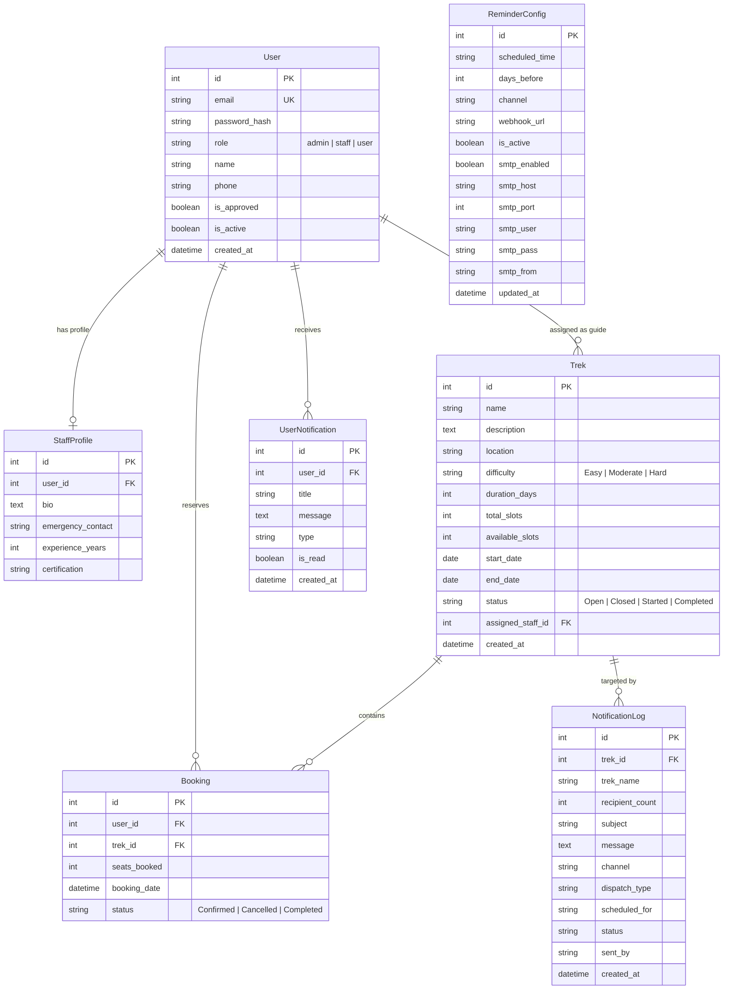

# Trekking Management Application (TMA V2) — Project Report

**Course:** Modern Application Development II (MAD 2) — Coursework Project  
**Student Name:** Hemant Singh Chauhan  
**Roll Number:** 24f2005964  
**Degree:** IIT Madras BS in Data Science and Applications  
**Project Repository:** Trekking-Management-Application-V2

---

## 1. Problem Statement & Architecture Approach

Commercial and community trekking organizations struggle with coordinating expedition routes, certified mountain guides, and trekker reservations. Key operational challenges include overbooking risks on sensitive alpine trails, lack of role-segregated management for guides, manual reminder overheads, and fragmented participant record keeping.

**TMA V2** solves these challenges by providing a centralized multi-role web platform:
- **Role-Based Access Control (RBAC):** Strict boundaries separating Platform Administrators, Trek Staff Guides, and Registered Trekkers.
- **Transactional Booking Protection:** Atomic slot decrementing and real-time overbooking guards preventing trail overcapacity.
- **Asynchronous Batch & Scheduled Jobs:** Automated Celery Beat jobs for daily expedition reminders, monthly administrative HTML/PDF analytics reports, and on-demand user CSV exports.
- **High-Performance Caching:** Redis multi-tier caching with time-to-live (TTL) expiry and event-driven invalidation hooks on booking and trek mutations.

```
       +---------------------------------------------------------+
       |             Vue.js 3 Single Page Application            |
       |  (Bootstrap 5 UI + Vite + Pinia + Vue Router + Axios)  |
       +----------------------------+----------------------------+
                                    | HTTPS / REST JSON API
                                    v
       +---------------------------------------------------------+
       |                    Flask Application                    |
       |         JWT Authentication + RBAC Route Guards          |
       +--------------+---------------------------+--------------+
                      |                           |
             SQLAlchemy ORM                 Cache & Tasks
                      |                           |
                      v                           v
       +------------------------------+  +-------------------------------+
       |       SQLite Database        |  |         Redis Server          |
       |  (Application Persistence)   |  | (Cache & Celery Task Broker)  |
       +------------------------------+  +---------------+---------------+
                                                         |
                                                         v
                                         +-------------------------------+
                                         |         Celery Worker         |
                                         | (Daily Reminders, Reports, CSV|
                                         +-------------------------------+
```

---

## 2. Technology Stack & Frameworks

| Layer | Technology | Justification & Role |
|:---|:---|:---|
| **Backend API** | Python 3.9+ / Flask 3.1.3 | Lightweight, deterministic RESTful microframework |
| **ORM & Database** | SQLAlchemy 2.0 / Flask-SQLAlchemy 3.1 / SQLite 3 | Relational persistence with foreign keys and cascade rules |
| **Authentication** | Flask-JWT-Extended 4.7.1 | Stateless JWT token headers and query string support with role verification |
| **Caching** | Flask-Caching 2.3.1 / Redis 7.0 | Redis-backed caching of frequently accessed routes with 300s TTL |
| **Task Queue & Jobs** | Celery 5.6.3 / Redis Broker | Background execution of daily reminders, monthly reports, and CSV batch exports |
| **Frontend Framework** | Vue.js 3.4 (Composition API) | Reactive single-page user interface built with Vite 5.4 |
| **Styling & Icons** | Bootstrap 5.3.3 / Bootstrap Icons | Responsive mobile/desktop enterprise layout without native alerts |
| **PDF Reporting** | ReportLab 3.6.13 | High-fidelity programmatic vector PDF generation |

---

## 3. Entity-Relationship (ER) Architecture

The application persistence layer is implemented in SQLite via SQLAlchemy models:



---

## 4. Implemented REST API Endpoints

### 4.1. Authentication (`/api/v1/auth`)
- `POST /register`: Self-registration for trekkers and staff applicant profiles.
- `POST /login`: Validates credentials, checks `is_active` (blacklisting guard), verifies staff admin-approval, and returns JWT access token.
- `GET /me`: Returns profile details of currently authenticated user.
- `POST /logout`: Client-side revocation and cleanup.

### 4.2. Administrator Operations (`/api/v1/admin`)
- `GET /dashboard`: Aggregated statistics (total treks, capacity, bookings, active staff/trekkers) with 60s Redis caching.
- `GET /users`: Search and filter users by role and keyword query `?q=`.
- `PUT /users/<id>/approve`: Approves pending staff accounts.
- `PUT /users/<id>/toggle-status`: Deactivates/blacklists or re-activates accounts.
- `DELETE /users/<id>`: Permanently removes a user, gracefully restoring booked slots or unassigning routes.
- `POST /staff`: Admin creation of pre-approved trek staff coordinators.
- `GET /treks`, `POST /treks`: Lists all routes and creates new expeditions.
- `PUT /treks/<id>`, `DELETE /treks/<id>`: Modifies route details and safely handles deletion.
- `PUT /treks/<id>/assign-staff`: Assigns approved staff coordinators to trek routes.
- `GET /bookings`: Historical ledger of all reservations across the system.
- `POST /reports/generate`: Generates on-demand monthly trekking activity PDF and HTML reports.
- `GET /reports/download/<filename>`: Secure file retrieval for generated monthly reports.
- `GET /reminders/config`, `PUT /reminders/config`: Reads and updates Celery reminder schedule parameters and SMTP configurations.
- `POST /reminders/send-now`: Immediate manual dispatch trigger for upcoming trek reminders.

### 4.3. Trek Staff Operations (`/api/v1/staff`)
- `GET /dashboard`: Metrics for assigned routes, confirmed participants, and ongoing trek statuses.
- `GET /treks`: Lists routes assigned specifically to the authenticated staff member.
- `PUT /treks/<id>/slots`: Updates remaining available seats (enforcing that capacity cannot be reduced below active bookings).
- `PUT /treks/<id>/status`: Updates route status (`Open`, `Closed`, `Started`, `Completed`). Setting `Completed` auto-completes bookings.
- `GET /treks/<id>/participants`: Lists registered trekkers, contact information, and seat allotments for assigned routes.

### 4.4. Trekker Operations (`/api/v1/trekker`)
- `GET /treks`: Lists discoverable Open expeditions with Redis caching, keyword search (`?q=`), and difficulty filtering.
- `POST /treks/<id>/book`: Atomically reserves seats with concurrency guards and overbooking prevention.
- `GET /bookings`: Chronological ledger of user's active and historical reservations.
- `PUT /bookings/<id>/cancel`: Cancels booking, releases seats back to the route exactly once, and preserves record history.
- `GET /profile`, `PUT /profile`: Fetches and updates user profile and credentials.
- `POST /bookings/export`: Triggers Celery async batch job to compile booking history into CSV.
- `GET /exports/<task_id>/download`: Direct authenticated download of the compiled CSV export.

---

## 5. Background Jobs, Performance & Verification

1. **Scheduled Daily Reminders:** Celery Beat task `tasks.send_daily_reminders` executes daily at the configured time (default 08:00 UTC). Scans treks departing within the threshold window (1 to 5 days) and dispatches personalized reminders with gear advice via Google Chat Webhooks, live Gmail SMTP, or server logs.
2. **Monthly Activity Report:** Celery Beat task `tasks.generate_monthly_report` fires on the 1st of every month (`0 0 1 * *`). Aggregates previous month metrics (conducted treks, participant totals, top popular treks) and compiles an executive HTML & PDF report.
3. **Async CSV Export:** Celery task `tasks.export_bookings_csv` executes asynchronously when requested by a trekker. Compiles User ID, Trek Name, Location, Status, and Dates into a downloadable CSV, presenting an alert upon completion.
4. **Automated Testing Suite:** 18 automated integration test suites verify full test coverage (`pytest -v tests/`):
   - Auth flows, staff approval gating, and admin user deletion.
   - Competing concurrency bookings for the last remaining slot.
   - Cross-staff route isolation and capacity floor checks.
   - Non-open trek booking rejections and immediate session deactivation.
   - Daily reminders, monthly PDF/HTML reports, and CSV batch exports.

---

## 6. Academic Honesty & AI Declaration

I declare that this coursework submission represents my own work in accordance with the IIT Madras Code of Academic Integrity.

- **Mandatory Student-Owned Components:** In compliance with course constraints, the core Trek entity architecture, user authentication and authorization logic, and Celery asynchronous task execution were authored and verified by the student.
- **Permitted AI Assistance:** Generative AI tools (Antigravity / Gemini) were utilized strictly as code auditors, test harness designers, and diagnostic reviewers to inspect existing student implementations, ensure adherence to PEP 8 / Vue best practices, optimize frontend bundle sizes, and verify edge-case coverage (such as concurrent booking collisions).
- **Video Submission:** The walkthrough presentation video was recorded by the student and demonstrates live platform features, database seeding, staff coordination workflows, and background job dispatching.

**Student Signature:** Hemant Singh Chauhan  
**Date:** 2026-11-18

